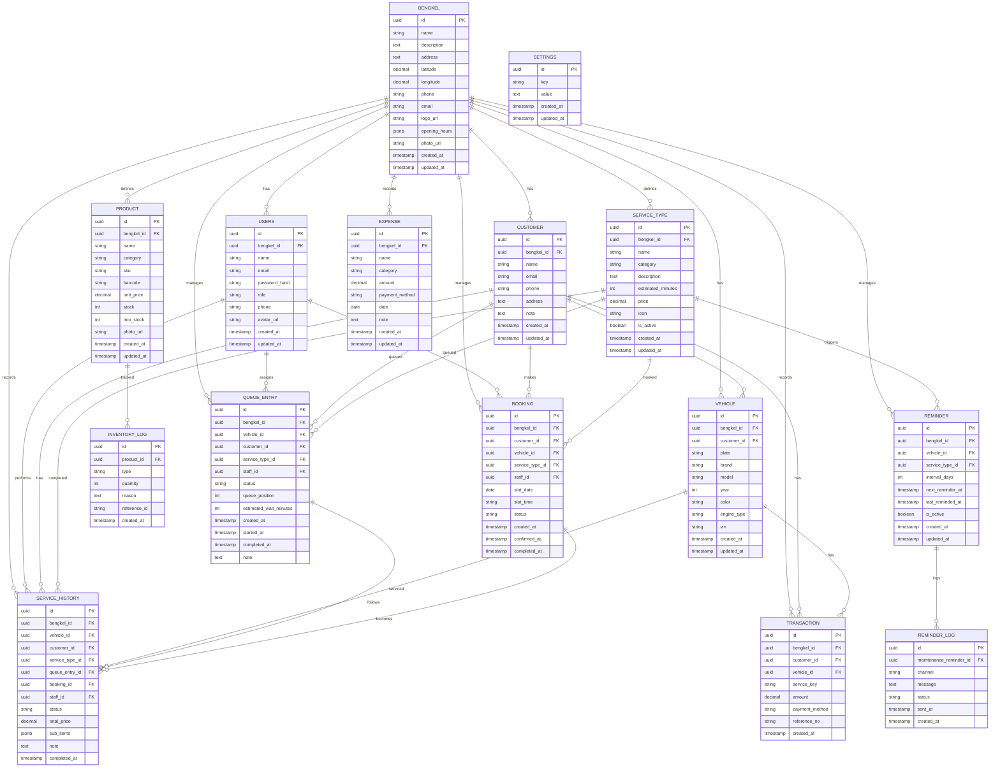

# Database Schema — Manajemen & Katalog Bengkel

Skema relasional untuk backend Manajemen & Katalog Bengkel (car workshop).

## Cara baca diagram ini

- **`PK`** = Primary Key (kolom yang jadi ID utama, unik).
- **`FK`** = Foreign Key (kolom yang "menunjuk ke" tabel lain).
- Garis `||--o{` artinya **1 → banyak** (misal `BENGKEL ||--o{ CUSTOMER` = 1 bengkel punya banyak customer).
- `SETTINGS` **tidak punya FK** karena tabel konfigurasi key-value, sengaja tidak terikat ke tabel lain. Sisanya yang tadi ditanya (`USERS`, `TRANSACTION`, `EXPENSE`, `REMINDER_LOG`) sudah ikut digambar hubungannya sekarang.

Gambar ER dibawah ini dibuat dengan **Mermaid** (`erDiagram`), siap dibuka di VS Code (ekstensi Mermaid Utils / Markdown Preview Mermaid Support).

> Catatan: tipe field (`uuid`, `decimal`, `jsonb`, `timestamp`) adalah panduan, belum jadi file migration SQL.

## Diagram ER

## Foreign Key Mapping (relasi eksplisit)

| Tabel | Kolom `(FK)` | Menunjuk ke |
|---|---|---|
| `USERS` | `bengkel_id` | `BENGKEL.id` |
| `CUSTOMER` | `bengkel_id` | `BENGKEL.id` |
| `VEHICLE` | `bengkel_id` | `BENGKEL.id` |
| `VEHICLE` | `customer_id` | `CUSTOMER.id` |
| `SERVICE_TYPE` | `bengkel_id` | `BENGKEL.id` |
| `PRODUCT` | `bengkel_id` | `BENGKEL.id` |
| `QUEUE_ENTRY` | `bengkel_id` | `BENGKEL.id` |
| `QUEUE_ENTRY` | `vehicle_id` | `VEHICLE.id` |
| `QUEUE_ENTRY` | `customer_id` | `CUSTOMER.id` |
| `QUEUE_ENTRY` | `service_type_id` | `SERVICE_TYPE.id` |
| `QUEUE_ENTRY` | `staff_id` | `USERS.id` |
| `BOOKING` | `bengkel_id` | `BENGKEL.id` |
| `BOOKING` | `customer_id` | `CUSTOMER.id` |
| `BOOKING` | `vehicle_id` | `VEHICLE.id` |
| `BOOKING` | `service_type_id` | `SERVICE_TYPE.id` |
| `BOOKING` | `staff_id` | `USERS.id` |
| `REMINDER` | `bengkel_id` | `BENGKEL.id` |
| `REMINDER` | `vehicle_id` | `VEHICLE.id` |
| `REMINDER` | `service_type_id` | `SERVICE_TYPE.id` |
| `REMINDER_LOG` | `maintenance_reminder_id` | `REMINDER.id` |
| `SERVICE_HISTORY` | `bengkel_id` | `BENGKEL.id` |
| `SERVICE_HISTORY` | `vehicle_id` | `VEHICLE.id` |
| `SERVICE_HISTORY` | `customer_id` | `CUSTOMER.id` |
| `SERVICE_HISTORY` | `service_type_id` | `SERVICE_TYPE.id` |
| `SERVICE_HISTORY` | `queue_entry_id` | `QUEUE_ENTRY.id` |
| `SERVICE_HISTORY` | `booking_id` | `BOOKING.id` |
| `SERVICE_HISTORY` | `staff_id` | `USERS.id` |
| `TRANSACTION` | `bengkel_id` | `BENGKEL.id` |
| `TRANSACTION` | `customer_id` | `CUSTOMER.id` |
| `TRANSACTION` | `vehicle_id` | `VEHICLE.id` |
| `EXPENSE` | `bengkel_id` | `BENGKEL.id` |
| `INVENTORY_LOG` | `product_id` | `PRODUCT.id` |

## Ringkasan field penting

| Tabel | Field penting | Keterangan |
|---|---|---|
| `BENGKEL` | `address`, `latitude`, `longitude`, `opening_hours` | Profil, lokasi, jam buka (jsonb) |
| `USERS` | `email`, `password_hash`, `role` | Login staff/admin — `role` = `admin` \| `staff` |
| `CUSTOMER` | `phone`, `email` | Pemesan/pengunjung |
| `VEHICLE` | `plate`, `brand`, `model`, `vin` | Kendaraan — bisa banyak per customer |
| `SERVICE_TYPE` | `category`, `estimated_minutes`, `price` | Jenis servis & harga |
| `PRODUCT` | `stock`, `min_stock`, `unit_price` | Sparepart |
| `QUEUE_ENTRY` | `status`, `queue_position`, `estimated_wait_minutes` | Antrean real-time |
| `BOOKING` | `slot_date`, `slot_time`, `status` | Slot antrean terjadwal |
| `REMINDER` | `interval_days`, `next_reminder_at` | Jadwal pengingat per `service_type` |
| `REMINDER_LOG` | `channel`, `status` | Log notifikasi (`sms/push/email`) |
| `SERVICE_HISTORY` | `status`, `total_price`, `sub_items` | Riwayat servis + produk yang dipakai |
| `TRANSACTION` | `amount`, `payment_method` | Pemasukan (income) |
| `EXPENSE` | `amount`, `category`, `date` | Pengeluaran RAB |
| `INVENTORY_LOG` | `type`, `quantity` | Stok sparepart in/out |
| `SETTINGS` | `key`, `value` | Konfigurasi (reminder interval, currency, dll) |

## Hal yang perlu diputuskan nanti

- **Tipe uang**: `decimal(12,2)` + format IDR. (NB: JSON/DB `float` tidak dipakai untuk uang.)
- **Waktu**: `timestamp with time zone` (UTC) untuk `created_at`/`updated_at`.
- **Multi-bengkel**: `bengkel_id` di tiap tabel sebagai tenant key — siap 1 bengkel saja maupun banyak.
- **Real-time queue**: pola polling / WebSocket dari `QUEUE_ENTRY.status` dan `queue_position`.
